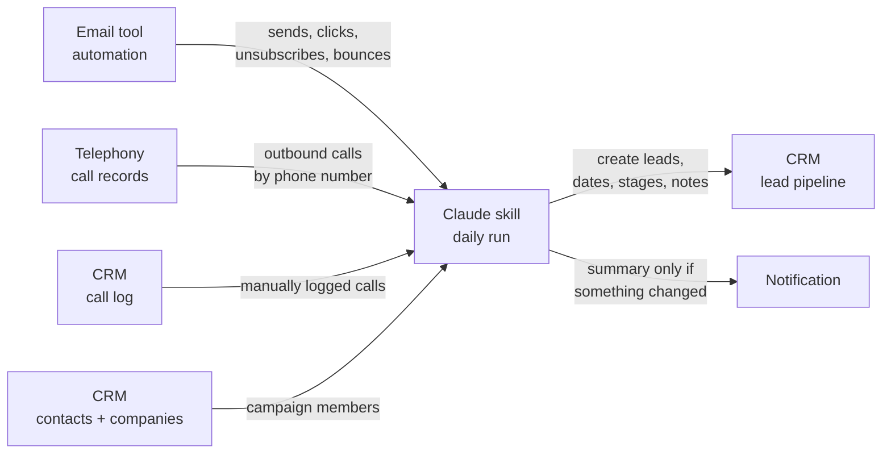

# CRM activity sync: a Claude skill

**The problem this solves:** outbound often runs across tools that don't talk to each other. Emails go out from an email-marketing tool, calls are made through a cloud telephony system, and the pipeline lives in the CRM. Copying sends, clicks, unsubscribes and call attempts into the CRM by hand is slow, and the CRM is always behind.

**The pattern:** a Claude skill that runs once a day, reads activity from every source, and writes it to the CRM as one lead per contact person, with dates, stages and notes.

**Example stack:** Claude (skill + MCP connectors) · HubSpot · MailerLite · a telephony REST API · small Python helpers

---

## Architecture

## What the skill does

1. **Leads.** Every campaign contact with a phone number gets exactly one lead, linked to the contact and their companies. Leads are per person, not per company, because several people at one company are often worked separately.
2. **Email activity.** Send dates per email step go into date fields. A click moves the lead forward and adds a note; an unsubscribe disqualifies it; a bounce flags the contact.
3. **Calls.** Calls are matched to contacts by normalised phone number, merged with calls logged by hand, and turned into *1st call date* and *2nd call date*.
4. **Summary.** A short report of what changed. As a scheduled task, it only notifies when something changed or failed.

## Design rules

- **Idempotent:** compare before writing, so a re-run changes nothing that is already correct and never logs a note twice.
- **Stages only move forward,** and other pipelines are never touched.
- **Duplicates are flagged, not deleted.** Deleting stays a human decision.
- **Secrets stay in environment variables,** never in files, notes or logs.
- **Small write batches,** with every result checked.

## Technical lessons (tool behaviour, not client data)

| Issue | Fix |
|---|---|
| CRM SQL-style queries cap the number of rows | Query in both sort directions and dedupe |
| Some APIs reject Python's default HTTP client | Use `curl` and pause between pages |
| Telephony timestamps are UTC | Convert to the team's time zone before taking the call date |
| Corporate link scanners create fake email clicks | Ignore known scanner domains |
| Phone numbers are stored in many formats | Normalise to E.164 before matching |
| Search indexes lag a few seconds after writes | Expect small count differences right after an update |
