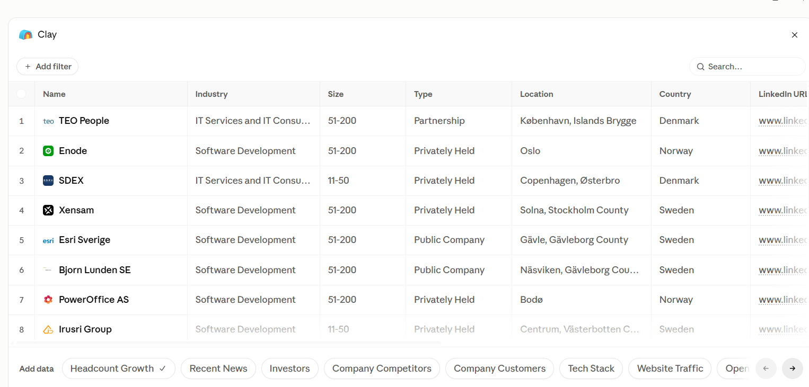

# Signal-based account qualification in Clay: a real run

**Question:** which Nordic B2B software companies are building an outbound sales team *right now*? These are the companies an outbound agency would want to talk to.

**Stack:** Clay (company search, standard enrichments, Claygent AI columns), run from Claude through the Clay MCP connector, then reviewed by hand.

**Run date:** October 2026 · 15 companies · public data only



---

## 1. Search

```sql
select from companies
where industry in ("Software Development", "IT Services and IT Consulting")
  and products_and_services is_similar_to ("B2B SaaS platform", "energy management software",
        "sustainability reporting software", "carbon accounting software")
  and company_size in ("11-50", "51-200")
  and locations.any(country_name in ("Sweden", "Denmark", "Norway", "Finland")
                    and is_headquarters = true)
limit 15
```

The search is deliberately wide. Industry codes and a semantic product match always pull in look-alikes; the next columns sort them out.

## 2. Enrichment columns

| Column | Type | Question |
|---|---|---|
| ICP Fit | AI (Claygent) | Does the company sell its *own* B2B software, or is it an agency, outsourcer or reseller? |
| Outbound hiring signal | AI (Claygent) | Open SDR, BDR, AE or sales-leadership roles, with the source URL |
| Headcount Growth | Standard | 3-, 6- and 12-month growth |

## 3. Results

| Company | Country | AI: ICP Fit | After review | Outbound signal | 12-mo headcount |
|---|---|---|---|---|---|
| **Enode** | NO | Fit | ✅ Fit | **Account Executive** (job board) | +10% |
| **Boards on Fire** | SE | Fit | ✅ Fit | **Chief Sales Officer** (careers page) | +8% |
| Polar | SE | Fit | ✅ Fit | none | +78% |
| PowerOffice | NO | Fit | ✅ Fit | none | +15% |
| Xensam | SE | Fit | ✅ Fit | none | +7% |
| EMD International | DK | Fit | ✅ Fit | none | +5% |
| Fiftytwo | DK | Fit | ✅ Fit | none | −7% |
| Atmoz | SE | Fit | ✅ Fit | none | −15% |
| Bjorn Lunden | SE | Fit (no label) | ✅ Fit | none | ⚠️ wrong record |
| Decision Focus | DK | Fit | ✅ Fit | none | ⚠️ wrong record |
| Irusri Group | SE | Fit | ❌ Agency | none | −13% |
| Gain Solutions | NO | Fit | ❌ Agency | none | n/a |
| SDEX | DK | No fit | ❌ Outsourcing | none | 0% |
| Esri Sverige | SE | No fit | ❌ Reseller | none | +5% |
| TEO People | DK | No fit | ❌ Agency | none | ⚠️ wrong record |

**Funnel:** 15 found → 12 marked Fit by AI → **10 after human review** → **2 with an outbound signal**.

## 4. What the review caught

**The AI fit column over-includes.** Two development agencies were marked "Fit" because each has a small product next to its service business. The prompt asked "do they sell their own product?" when the real question is "is a product their main business?" Without review, both would have gone into the sequence.

**Output format drifted.** The prompt asked for "Fit / No fit" plus one sentence. Most answers followed it, but one came back with no label and others with extra markdown headings. A column you filter on needs a strictly fixed output.

**3 of 15 headcount records belonged to another company.** Clay showed 3, 16 and 17 employees for companies whose own profiles say 66, 153 and 165. That's a 20% error rate on a standard enrichment, and any "growing team" message based on those numbers would have been wrong.

**The signal needs interpreting.** Enode hiring an Account Executive is a classic "scaling sales" signal. Boards on Fire hiring a Chief Sales Officer means it is *building* its sales function, an earlier stage that calls for a different message. Polar is the fastest-growing company in the set but has no open sales roles: one to monitor, not to contact yet.

## 5. Prompt v2 (after review)

```
Is selling its own B2B software product this company's MAIN business
(the product has its own pages, pricing or customers, and is the focus
of the homepage)? Development agencies, outsourcers, consultancies and
resellers are "No fit", even if they also have a side product.

Answer with exactly one line:
Fit | <reason, max 20 words>
or
No fit | <reason, max 20 words>
```

Plus one new column: **Headcount check**, flagging any row where the growth record's employee count differs from the company profile by more than 30%.

## 6. From signal to first line

For qualified accounts, the signal becomes the opener (company level, before choosing a person):

| Account | Signal | Angle |
|---|---|---|
| Enode | Hiring an Account Executive | Scaling sales: the AE needs pipeline from day one |
| Boards on Fire | Hiring a CSO | Building the sales function: outbound as part of the new setup |

The next step runs these accounts through the [trigger-research skill](../skills/trigger-research/SKILL.md) to find the right person and draft the message.
