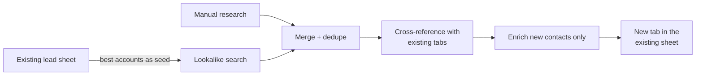

# List operations and a pricing model template

Two kinds of spreadsheet work that come up constantly in outbound teams: merging lists from several sources without breaking anything, and working out what to charge when automation changes the cost base.

**Stack:** Claude · Google Sheets MCP · Python / openpyxl for .xlsx files

---

## 1. Merging lists from several sources

**Typical inputs:** a client's existing lead sheet, lookalike results from a data provider, and hand-researched contacts (for example, people connected to an event).

**Columns that make the result usable**

| Column | Why |
|---|---|
| Lead status | Carried over if the person is already known |
| Why this lead | A one-line reason, marked *verified* or *reported* |
| Call reason | An opener for the caller |
| Already in contacts / companies? | Prevents calling existing relationships |

**Rules**
- Work inside the existing file: add a tab, don't send a new file that someone has to merge back.
- Enrich only contacts that are new, and report the data cost per list.
- Separate *verified* reasons (source checked) from *reported* ones (taken from notes).
- Reconcile at the end with a match count ("X matched, Y flagged").

## 2. Pricing model template

When automation cuts hours but raises tool and data costs, hourly billing stops reflecting real cost. A small workbook makes the trade-offs visible:

| Tab | Contents |
|---|---|
| README | How to use it, and every assumption |
| Assumptions | Editable inputs: hourly cost, rate, target margin, data markup, exchange rate, number of clients |
| Tools | Fixed overhead vs. variable usage (data credits, sending) |
| Cost summary | Monthly cost per client, with a check cell against the source total |
| Pricing | Hourly + tooling fee, blended rate, per deliverable, and retainer with included volume, side by side |

All numbers flow from the Assumptions tab, and input cells are colour-coded. Before building, clean the source: remove cancelled tools, fill in missing costs, and fix currency mix-ups.
