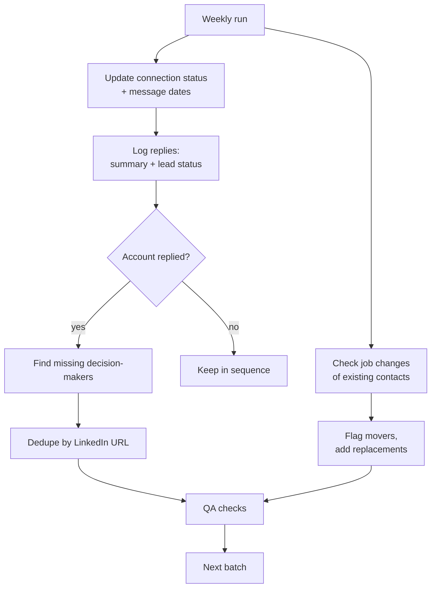

# Account-based list building

**Goal:** build a contact base from scratch, for example to enter a new market, and keep it useful while outreach runs week by week.

**Example stack:** Lusha (or a similar data provider) · Google Sheets · LinkedIn · Claude for structure, QA and the update routine

---

## How to build it

1. **Accounts first, in batches.** Select target organisations by location and industry, and roll out one region or segment at a time, so each batch can be worked and measured on its own.
2. **A buying committee per account, not one contact.** For each organisation, find the roles that influence the purchase:

   | Role group | Why |
   |---|---|
   | IT / technical owner | Integration and the technical decision |
   | Purchasing / operations | The buying process and the operational pain |
   | Daily users' manager | The workflow your product changes |
   | Leadership | Sign-off |

   A reply from any one of them opens the account.
3. **Enrich once, completely:** person data (role, LinkedIn, email, phone) and company data (website, company page, address). Where something can't be verified, the cell says so instead of guessing.
4. **Outreach columns from day one:** connection request date → status → 1st message date → replied → lead status. If the list goes into a CRM, the CRM fields are filled for every batch, not just the first.

## The key move: go deeper where someone answered

Keep a view of (1) everyone who replied and (2) their not-yet-contacted colleagues at the same organisations. Group 2 is the warmest next step.

## Weekly update routine

**QA checks before saving**
- Dates in the future.
- Company links or websites that belong to another organisation (often copied from the row above).
- Duplicates, matched on LinkedIn URL, not name, because names are written in many variants.
- "New" lead status on anyone who has replied.

## Principles

- **A list is a process, not a file.** It stays useful only with a fixed routine and checks.
- **Replies are qualification data.** A "not a fit" reply should change the targeting of the next batch.
