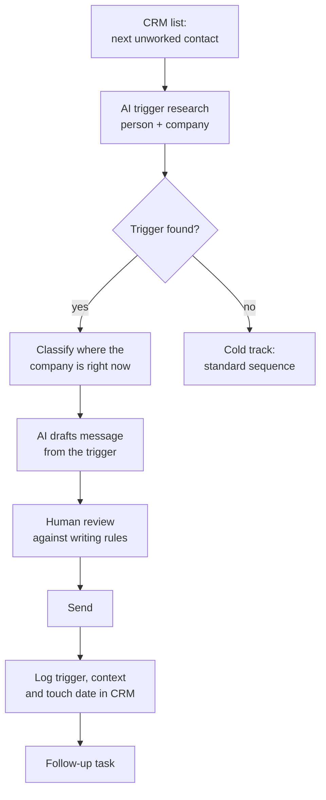

# Trigger research and personalised messaging

**The idea:** research each lead before anyone contacts them, write from what you find, and store the research in the CRM so every later touch (email, LinkedIn, call) builds on it.

**Example stack:** HubSpot · an AI research step · an AI drafting step (Claude or a custom GPT) · LinkedIn · human review

---

## Flow

## Step 1: Research

Two questions per lead:
- **Is there a reason to talk now?** Hiring, funding, a launch, a new role, an expansion. The finding and its source go into a note on the company record.
- **Where is the company right now?** A short, fixed set of stages relevant to what you sell (for example: early product, growing, scaling, consolidating). Stored as a CRM property, so the caller sees the right angle before calling.

## Step 2: Writing

One drafting prompt writes all touches, depending on the input: research → 1st message; research + "2nd" → a new angle; research + "3rd" → a short final touch.

**Writing rules**
- 3–4 sentences, in the prospect's working language.
- Open with their trigger.
- Talk about their problem or goal, not about your hours or rates.
- End with one question they can answer in a line.
- No sales language, competitor mentions or "just following up".

**Example** (fictional):
> Saw that Northwind Planning opened two backend roles right after launching its scheduling module. Teams at that point often find the roadmap moves faster than hiring does. How are you handling the gap until the new people are up to speed?

## Step 3: Tracking

- **One source of truth** for touch dates: a single tracker on the lead record, not scattered contact fields.
- **Automatic follow-up tasks** after each touch.
- **Triggered vs. cold leads reported separately,** so the team sees real pipeline, not just volume.

## Testing what works

A simple design for questions like "call first or call later?": split a triggered list into two equal groups, change one thing (the position of the call in the sequence), and compare conversations and meetings per group.

## Principles

- **No trigger, no personal message.** Those leads go into a standard sequence.
- **AI drafts, a human sends.** Review catches research mistakes.
- **Everything lands in the CRM,** where the next person needs it.
